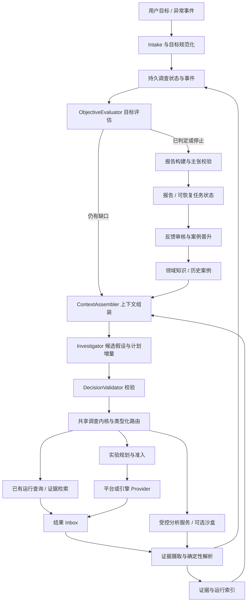

# 游戏测试 Agent 整体架构改进方案

版本：讨论稿 v1.0 · 日期：2026-09-20

适用范围：当前 `game-test-agent` 仓库的通用调查控制面、provider 契约、证据处理、推理与报告链路。本文是后续实施方案，不代表所列能力已经实现。

## 1. 核心建议

把当前“可运行的模型驱动测试闭环”升级为“可恢复、可验证、能积累经验的调查系统”。主线是：**可信执行与证据 → 目标评估与自适应调查 → 上下文工程 → 跨任务知识 → 隔离分析与有限专家协作**。

继续使用现有 Temporal、MCP、Repository、ArtifactStore 和模型适配层。新增能力以领域契约和共享服务接入，不为了使用某种 Agent 框架重写整个系统。

近期优先级不是扩大模型自主权，而是让模型看到完整的调查状态，并让执行器准确落实模型意图。证据去重和 query/experiment 混淆暴露的是通用架构问题：文件身份、观测身份、实验身份和动作身份尚未彻底分离；调查完成状态也尚未形成统一的可计算依据。

建议采用四项基础决策：

1. 模型提出候选决策，确定性内核校验并执行；模型不直接修改账本、预算或权限。
2. 每次真实执行、观测、解析和判断都有独立身份及溯源链；压缩和缓存不能改变这些身份。
3. 任务是否完成、测试是否通过、根因是否确认分别表达；报告与停止策略消费同一份目标评估结果。
4. 先形成单调查的可靠工作记忆，再引入跨调查经验；所有增强都通过轨迹评测证明收益。

## 2. 判断依据与当前能力边界

本文重新阅读了当前代码、实现状态文档及原始设计稿，并结合用户提供的模型联调结果。用户报告的耗时、模型表现、`83 passed` 和 Ruff 结果属于既有验收记录；本次编写方案没有重新执行模型联调或测试套件。

已有基础值得保留：严格契约、项目/权限过滤、动作幂等账本、预算预留、不可变证据、确定性解析、报告校验、Temporal 恢复机制、事务 Outbox、模型接口配置和参考 MCP provider。模型已展示选择能力、构造参数、识别补证需求的能力，但模拟联调不能证明真实引擎适配与复杂诊断可靠性。

原始设计稿已提出工作记忆、按需检索、假设图和专家协作。此次改进以这些设计与当前执行路径之间的差距为起点，补充明确的数据模型、服务边界、迁移步骤和验收门槛。

| 代码现状 | 架构影响 | 改进落点 |
| --- | --- | --- |
| SQLite 和 MySQL 初始 Schema 均按调查与内容哈希唯一约束证据 | 不同运行返回同内容时可能丢失独立观测 | Artifact、Observation、Run 分层 |
| `add_evidence()` 将完整性异常统一返回 `False`；manifest 摄取仍把输入记录加入后续解析列表 | 重复提交、身份冲突和真实失败难区分；待解析记录可能未入账 | 类型化摄取结果与持久化记录引用 |
| `NextStep` 有 query/experiment，但两个执行后端对其均进入规划提交路径 | 读取意图可能变成新执行；成本和权限语义不一致 | 判别联合类型、语义路由和准入 |
| `ActionService.reconcile()` 在动作终态时返回 `None`，当前方法没有将完整 `RunResult` 作为可重读终态结果持久化 | 结果返回后、证据摄取前崩溃的恢复存在风险；须用故障注入验证 | RunResult inbox、终态结果缓存及摄取游标 |
| ContextBuilder 截取最近 100 条证据/动作，facts、hypotheses、用户输入及能力集合没有 token 预算 | 旧反证可能丢失；任务变长时上下文仍可能膨胀 | 版本化工作状态、相关性检索、全局 token 预算 |
| 当前 `repeat_index` 从上下文中的同能力动作数量推导，且以引用证据作为条件 | 截断、并发及失败尝试可能影响编号；实验目的未被强约束 | 事务内实验组与运行序号分配 |
| 动作语义哈希包含 `expected_observation` 等描述字段 | 同一实际操作可能因措辞不同而绕过去重 | 只对规范化执行参数构建语义身份 |
| StopPolicy 支持 `goal_met`，本地调用未传入；运行预算检查先于目标检查 | 达到执行额度后，即使已有充分结果也可能被预算原因覆盖 | 每次观察后评估目标，按操作种类准入预算 |
| 本地循环和 Temporal 循环分别实现决策、等待和退出 | 修改一个后端不能保证另一个后端获得相同语义 | 共享调查内核与后端一致性验收 |
| ReportBuilder 默认 inconclusive/observation，目标默认未覆盖；Worker 使用 `publish_inconclusive_report` | 修复证据摄取后，也不会自动获得完整目标判定能力 | ObjectiveEvaluator 与结论驱动的报告构建 |
| ConclusionEvaluator 主要检查引用、来源和结论等级；因果门禁还依赖证据 kind | “存在某类文件”不足以证明某个因果主张成立 | 主张—事实—实验的语义支持校验 |
| 现有离线评测直接检查候选报告 | 无法衡量计划质量、恢复能力、及时停止和完整任务成功率 | 多轮轨迹评测与真实环境验收 |

以上是当前实现观察，不将所有潜在风险表述为已复现故障。

## 3. 先进架构参考与本项目取舍

参考资料以官方文档和工程文章为主，访问日期为 2026-09-20。下表概括来源观点；后续章节是结合本项目提出的设计，不代表原文要求或性能承诺。

| 来源 | 可借鉴原则 | 本项目选择 |
| --- | --- | --- |
| [Anthropic：Building effective agents](https://www.anthropic.com/engineering/building-effective-agents) | 简单可组合的工作流与 Agent 模式；依据任务复杂度逐步增加编排 | 确定性服务负责身份、执行、预算和计算，模型负责假设与候选实验 |
| [Anthropic：Scaling Managed Agents](https://www.anthropic.com/engineering/managed-agents) | 推理循环、持久会话与执行环境解耦；完整事件可在上下文之外重读 | 以业务账本保存事实，Temporal 负责持久调度，provider/沙盒独立承载执行 |
| [Anthropic：Effective context engineering](https://www.anthropic.com/engineering/effective-context-engineering-for-ai-agents) | 按需读取、压缩、结构化笔记，以及对有限上下文的选择 | 证据索引与任务摘要组合；关键反证常驻；摘要保留原文引用 |
| [LangGraph：Persistence](https://docs.langchain.com/oss/python/langgraph/persistence) | 单任务检查点与跨任务存储具有不同职责 | 区分任务工作状态和长期案例库；沿用现有数据库与 Temporal，无需引入第二套编排运行时 |
| [Anthropic：Demystifying evals for AI agents](https://www.anthropic.com/engineering/demystifying-evals-for-ai-agents) | 结合轨迹与结果，按问题选择代码、模型及人工裁判 | 身份/预算/调用语义用程序裁判；调查质量用标注与人工校准评估 |

不将“多 Agent”“向量数据库”“超长上下文”作为成熟度指标。只有它们在相同约束下改善任务完成质量，才升级为默认组件。

## 4. 目标架构



职责划分：

- **调查内核**：根据状态与事件生成合法下一步，管理目标、计划、评估及停止决策。
- **本地/Temporal 适配层**：执行内核命令、安排时间和重试；外部调用、模型调用、数据库操作留在 Activities/服务层。共享内核不把非确定性 I/O 带入 Temporal Workflow。
- **推理层**：消费冻结的上下文快照，输出结构化候选决策；不掌握真实设备写入或生产数据库凭据。
- **执行层**：按声明的操作类型、资源所有权和预算执行；重试不能变成新的实验。
- **数据层**：权威状态、不可变观测和原始产物；索引、摘要、案例属于可重建或可撤销的派生数据。

## 5. 证据、运行与实验身份重构（P0）

### 5.1 分离五种身份

| 对象 | 含义 | 身份/去重原则 |
| --- | --- | --- |
| Action | 系统准入的一次操作意图 | `action_id` 与幂等键稳定；重试保持不变 |
| Experiment | 回答一个问题的实验设计 | 绑定目标/假设、变量、对照条件、测量方法和停止标准 |
| Run | provider 实际执行的一次运行 | 按 tenant/project/provider/run_id 标识，关联 Action 与实验组 |
| Observation | 某次运行在某个采样位置得到的证据 | 按来源运行、来源证据 ID、来源修订标识；不同运行不按内容合并 |
| Artifact | 实际字节内容 | 在授权存储命名空间内按内容哈希复用；不代表独立样本 |

`EvidenceRecord` 可逐步演进为 Observation，不要求第一期再建一套同义实体。增加明确的来源键、关联动作、实验组、源修订和内部不可变 ID。

建议来源唯一键：`(tenant_id, project_id, provider_id, run_id, source_evidence_id, source_revision)`。未绑定运行的用户上传资料使用独立的来源类型和文档版本键，不能伪造 run，也不能自动计入独立运行数。

同一来源键及同内容是幂等重放；同一来源键但内容变化是冲突，应隔离并报告。允许更正时创建新修订并记录 `supersedes`，旧证据不覆盖。不同来源键即使哈希相同，也保留两条观测。

### 5.2 摄取与派生规则

- 将布尔返回值改为 `IngestOutcome(created/replayed/conflict/rejected, canonical_evidence_id, reason)`，不吞掉所有完整性异常。
- manifest 摄取以持久化后的 canonical ID 驱动解析。解析失败保留原始观测及失败原因，可以独立重试。
- 解析缓存可按内容哈希、解析器版本和参数复用数值，但每次观测的 Fact 仍须单独关联来源运行；不能复用上一运行的事实引用。
- Fact 身份包含观测、解析版本和指标/采样位置。解析升级形成新的派生修订，不改写历史报告引用。
- 同一次 run 的多个文件、同一文件的多个解析结果，不能按数量冒充多次独立复测。
- 独立 run ID 是独立执行的必要标识，不足以证明统计独立。增加环境复位、缓存命中、种子、输入和采样窗口等元数据；无法判断独立性时保留限制。

### 5.3 结果先入账，再执行后续处理

增加持久 `RunResultSnapshot`，按来源运行及 result revision 幂等保存。建议顺序：

```text
接收/查询结果
→ 校验来源、修订和关联动作
→ 同事务保存结果、更新动作状态、登记待摄取事件
→ 下载并校验产物
→ 幂等写入观测
→ 解析事实
→ 推进目标评估游标
```

远程对象存储与数据库无法做同一事务时，采用可重试阶段与孤立对象回收；不宣称端到端 exactly-once。系统目标是至少一次投递下，每个逻辑动作与观测保持一致的幂等效果。

终态查询返回已保存结果，而非 `None`。Worker 在“终态已记录、产物尚未摄取”时重启，应恢复摄取，不应重新启动测试。崩溃/执行失败也可能产生有效 dump 或日志，摄取不应仅由 `execution_status == succeeded` 决定。

## 6. 类型化决策与工具执行语义（P0）

将宽松的 NextStep 逐步替换为以 `kind` 判别的联合类型。对模型保持少量清晰选择，在服务端落实硬语义。

| 决策 | 必要字段 | 可产生的副作用 | 预算 |
| --- | --- | --- | --- |
| `query_run` | 已有 action/run/operation 的引用，查询目的 | 不创建新运行 | 外部读取额度 |
| `retrieve_evidence` | 检索条件或证据引用、片段范围 | 只读索引/产物 | 检索、读取及上下文额度 |
| `experiment` | 实验目的、精确能力版本、参数、预期判别条件 | 经准入后创建运行 | 执行次数、设备时间 |
| `analyze` | 输入观测、分析方法或受控分析程序 | 生成派生分析产物 | 分析 CPU/内存/时间 |
| `request_input` | 缺失字段、必要性及影响范围 | 等待输入 | 等待期限 |
| `report` | 目标评估 revision、报告理由 | 发布经校验的报告 | 报告生成预算 |

已有 `query` 兼容入口只能在意图与目标对象明确时映射；歧义返回结构化校验错误供模型修正，不能静默降级为 experiment。

CapabilityDescriptor 新增受信任的操作语义字段，例如 `operation_kind`、`creates_run`、`requires_existing_run`、`resource_mutation`、成本类别。`risk_level` 保留，但不能单独承担路由和计费职责。声明由可信 provider 注册配置验证，不能由模型自报。

DecisionValidator 校验目标、证据、能力及运行引用属于当前作用域；`query_run` 引用已有运行；参数满足 Schema；显式用户约束不可被改写。错误返回可修正字段及有限重规划次数，不把所有参数错误立即转成终案。

实验重复分为三类：同一动作的传输重试、同一实验的独立重复、改变变量的新实验。由 Repository 在实验组中事务分配运行序号，不从截断上下文统计 `repeat_index`。重复必须声明目的、上限和退出标准，但首次建立基线等合法实验不强制要求已有证据。

动作语义哈希只包含规范化执行输入：能力/provider 精确版本、构建、测试版本、目标资源、输入参数、环境及采样配置、实验组与受控重复序号。排除自然语言说明等非执行字段。新增重复序号不能绕过实验组上限或预算。

## 7. 目标评估、停止决策与报告（P0–P1）

### 7.1 建立可计算的验收目标

自然语言目标先规范化为 `ObjectiveSpec`，保留原文及每个字段的来源。支持阈值、相对回退、功能断言、复现频率、资源趋势、证据完整性以及因果诊断等规则类型，通过注册式 evaluator 扩展，不把逻辑写死在某一种指标里。

建议字段包括：目标类型、范围、指标及单位、比较操作、阈值/基线、采样方法、可比性条件、充分性要求、允许证据来源、规则版本。模型只能提出字段解释；阈值、环境和成功标准须来自用户或版本化项目规范，缺失时保持待确认。

目标评估返回 `CriterionAssessment`：

```text
criterion_id / rule_version / evaluated_state_revision
verdict: passed | failed | insufficient | not_applicable
scope: real_target | simulation | historical_reference
supporting_fact_ids / contradicting_fact_ids
missing_requirements / comparability_checks / limitations
```

数值计算由确定性 evaluator 完成。复杂根因判断可由模型提出候选，但确认等级必须绑定有效对照、干预结果及反证处理；“有 crash_dump 文件”不能直接成为根因确认依据。

### 7.2 分离三种结论

| 维度 | 回答的问题 |
| --- | --- |
| 目标判定 | 测试要求通过、失败，还是证据不足？ |
| 调查完成度 | 当前请求是否已被充分回答？ |
| 诊断强度 | 仅观察到异常、已复现、支持某瓶颈，还是确认根因？ |

验证型任务可在判定“不通过”后完成调查，不必继续追根因；诊断型任务则可能需要继续。模拟数据可以形成模拟范围内的指标判定，但真实目标保持未验证。避免把所有成功完成都映射为“测试通过”，也避免把尚未确认根因的所有任务都映射为“未完成”。

### 7.3 用统一评估驱动下一步

每次新结果/证据/用户输入持久化后，先更新目标评估，再决定是否继续调用模型。`report` 是发布建议，不能绕过评估；评估已充分回答目标时，也不必等待模型额外提出停止。

将 `StopPolicy` 拆成任务终止判断和操作预算准入：

- 取消、权限失效及墙钟截止禁止继续业务执行，进入报告/清理路径。
- 目标已经充分判定时正常完成，保留实际 verdict；不能因运行次数恰好到上限而覆盖为“证据不足”。
- 执行额度耗尽只阻止新增实验；剩余读取/分析额度仍可用于取得已运行任务结果与生成判断。
- 为取消、对账、清理和最终报告预留独立有界额度，不能因业务预算用完遗弃外部资源。
- “无进展”使用新增有效观测、运行状态推进、假设排除或目标缺口缩小判断；不使用截断列表长度或生成文本长度。

ReportBuilder 消费同一份冻结的 Assessment，输出目标覆盖、失败/不足原因、关键事实、证据链和限制。独立 ConclusionEvaluator 验证每项主张的范围与支持关系；可选模型审阅检查遗漏解释，但不得提高证据等级或无限重启调查。

## 8. 共享调查内核与持久化恢复（P1）

抽取 `InvestigationKernel`：输入为版本化调查状态和新事件，输出为状态增量、目标评估请求、类型化操作及停止决策。本地与 Temporal 后端共享决策规则，各自适配等待与 I/O。

建议补齐以下持久对象：`InvestigationStateSnapshot`、`DecisionRecord`、`ExperimentSpec`、`RunResultSnapshot`、`CriterionAssessment`、`ContextSnapshot`。沿用现有事件/事务能力，先实现关键边界的可恢复状态，不要求立即把全部 Repository 改成事件溯源系统。

恢复边界：

1. 调用模型前冻结输入、上下文哈希、权限快照、模型/提示/工具 Schema 版本。
2. 模型输出通过校验后持久化 DecisionRecord，再准备执行。
3. ActionProposal 和规范化 ActionSpec 在外部提交前保存；Activity 重试读取同一提案，不再次规划出不同参数。
4. UNKNOWN 动作先对账；已知运行优先等待/查询；只有明确的新实验意图才能创建另一运行。
5. 按调查 revision 乐观并发控制，旧决策执行前重新检查权限、目标状态和剩余预算。
6. 用户补充输入、重开、取消与迟到结果使用同一事件处理规则；对已发布报告生成新 revision，不改写旧版本。

模型请求超时但供应商可能已完成生成时，除非供应商支持请求幂等或结果查询，否则不能保证零重复推理成本；应记录不确定尝试并限制重试。外部实验仍由动作账本保护，不能随模型重试重复提交。

对每项状态转换建立 local/Temporal 语义一致性测试，覆盖等待输入、取消、结果摄取、预算耗尽、恢复和终态发布。

## 9. 计划、假设与诊断策略（P1）

现有 TestPlan、Hypothesis 和 EvidenceRelation 可继续扩展。让 Investigator 返回 `PlanDelta` 与 `HypothesisDelta`，由校验器更新账本；已运行步骤不可被模型删除，允许取消或替换尚未执行的步骤。

每个候选实验说明：要回答的问题、关联假设、控制/改变的变量、所需证据、不同结果会排除哪些解释、成本及停止标准。比较顺序可采用“先用已有证据、再低成本查询、最后真实复测”的默认启发式，但允许项目策略覆盖。

候选动作按预计缺口缩小、假设区分能力、环境可行性、成本与风险排序。分数是启发式，不表示精确概率或真实信息熵。记录预期收益和实际收益，供后续评测校准。

五类现有策略逐步升级为版本化 `DiagnosticPlaybook`：前置检查、必需字段、可选实验模板、适用条件、反证和结论边界。策略只绑定能力语义与数据要求，由 provider 映射到具体工具，不绑定某个 smoke case。

区分验收运行和诊断运行：改变画质、场景规模、输入或采样器的实验有助于定位，但不能直接混入原配置的验收统计。跨构建对照也需显式 experiment arms 和每组允许的 build；当前单一 build 严格校验不能通过取消来源检查来绕开。

## 10. 工作记忆、上下文索引与压缩（P1）

### 10.1 工作记忆先结构化

建立可从账本重建的 `InvestigationWorkingState`：当前目标及判定、活跃假设与反证、已完成/失败实验、在途运行、未取得产物、未解决问题、剩余额度、下一步候选。

这份状态与聊天历史、推理缓存不同。已经失败的实验、尚未完成的运行和关键反证不因上下文变长而消失。预算、权限、运行状态由数据库投影提供，不能从模型摘要反解析。

### 10.2 上下文四层结构

| 层 | 内容 | 处理方式 |
| --- | --- | --- |
| 固定规则 | 权限边界、证据规则、输出 Schema | 版本化、精简 |
| 必选工作状态 | 目标、约束、在途运行、关键反证、预算 | 每轮固定包含，避免被相关性排名过滤 |
| 相关片段 | 与当前目标/假设相关的事实、日志、历史步骤、工具定义 | 先按作用域过滤，再检索与排名 |
| 按需资源 | 原始日志、trace、截图、完整历史 | 仅提供索引和读取接口 |

统一限制输入 token，包含事实、假设、用户输入、能力 Schema 和历史案例，另预留模型输出及工具结果空间。不同模型使用相应 tokenizer 或保守估算并留出余量；超预算时先降低可选片段，不丢弃不可省略的约束。必要状态本身过大时拆分目标或进入显式缺口处理。

提供只读接口：`search_evidence(filters, query)`、`read_evidence(id, locator)`、`get_run(ref)`、`get_history(cursor, limit)`。所有检索先施加 tenant/project 与资料 ACL，再排名；摘要和引用片段同样受权限限制。

首期使用结构化字段索引与全文检索：运行、构建、场景、平台、指标、调用栈指纹、时间、错误类别、假设关系。向量检索仅作为后续召回补充；不能代替精确来源过滤或数值查询。

### 10.3 压缩保持可回查

摘要记录 `source_revision`、覆盖事件范围、来源 ID、生成器版本和摘要哈希。语义摘要可由模型生成；数值、预算、终态、已否定假设和未完成动作从结构化状态直接注入。

原始事件与证据仍保留。摘要过期、引用缺失或与当前状态冲突时重建/失效；不继续把旧摘要作为事实。不得反复只对上一份摘要再压缩，逐步丢失来源。

验收重点是压缩后的决策保持率、关键反证召回、历史失败实验再执行率和 token 成本，而非摘要长度本身。

## 11. 跨任务记忆与知识体系（P2）

分开三类长期资料：

| 类型 | 内容 | 写入与失效 |
| --- | --- | --- |
| 案例记忆 | 症状、环境、调查路径、有效/无效实验、确认结果 | 经可信反馈或人工审核晋升；附来源和适用版本 |
| 领域/项目知识 | 指标口径、测试目录、场景术语、引擎规则 | 版本控制与责任人审核 |
| 策略经验 | 某类证据下哪些查询更有效、哪些实验代价过高 | 基于多任务评测形成候选策略，灰度发布 |

生命周期为 `candidate → reviewed → active → deprecated/retracted`。记录作用域、可信等级、审核者、来源调查、适用引擎/构建区间、有效期及撤销原因。

历史相似案例用于提出假设和选择实验，不能作为当前构建已经复现或已确认根因的直接证据。索引失效、跨版本漂移和错误案例撤回都应反映在检索中。用户授权删除来源时，同步处理相关片段、摘要、索引和可删除的派生资料。

优先积累少量高质量案例，并做“有记忆/无记忆”的盲测。只有正确率、复测成本或耗时获得稳定收益，才扩大自动写入比例。

## 12. 沙盒、设备隔离与资源所有权（P1/P2）

分别建设测试执行隔离和数据分析沙盒，两者解决不同问题。

**真实测试隔离（随 provider 接入完成）**：设备/实例租约、运行账号与存档、场景和配置复位、随机种子、缓存状态、环境指纹、超时回收。共享设备上的状态修改由执行所有者串行协调；租约增加 fencing token，过期 Worker 不能继续写设备。

**分析沙盒（按需求启用）**：为模型生成的日志分析、统计或产物转换脚本提供受限执行环境。输入为只读挂载的已授权产物，输出为独立目录；限制 CPU、内存、进程、磁盘、时间和网络。生产凭据由外部 broker 持有，沙盒不继承 Agent 服务环境变量或宿主机控制接口。

沙盒按风险选择隔离强度；普通子进程不等于安全隔离，不以容器存在本身作为足够的安全证明。设备/GPU 测试由专用 runner 管理，不强制塞进通用分析容器。

保存分析代码哈希、环境镜像/依赖版本、输入证据 ID、参数、输出哈希及退出状态。生成的分析结论初始属于派生候选事实，经过格式、范围和数值复核后才用于报告。已有确定性解析器能完成的任务继续直接使用解析器。

通过现有 Cleanup Ledger 扩展跟踪运行、设备租约、沙盒、临时账号/目录和复位任务；清理失败可查询、可重试，有明确所有者。

## 13. 模型适配、成本治理与可选专家协作（P1/P2）

保留当前多模型接口配置，增加模型配置档案：API 模式、结构化输出能力、上下文上限、超时、输出上限、reasoning 配置、提示词版本及工具 Schema 版本。业务契约保持供应商中立。

所有模型调用都进入统一计量：调查推理、动作规划、摘要、报告及专家审阅。当前 `reasoning_rounds` 不足以代表模型总成本；补充实际调用次数、输入/输出 token、重试、时延和可获得的费用。费用数据未知时明确标记估算，不能记作零。

模型输出格式错误可有限重试或修复；业务语义错误返回校验反馈。模型不可用时，只允许退化到明确支持的确定性流程，不能把默认策略跑完当作模型调查能力验收。

默认一个主 Investigator。仅在独立复杂分析经评测证明有收益时启用 Crash/Performance/Memory 专家：输入为有界问题和证据引用，输出 `AnalysisFinding`（结论候选、支持/反证、缺口、建议实验）。专家默认只读，不能自行提交真实实验或继续派生专家；共享总预算，由主内核合并结果。

多个专家意见一致不是独立证据，不自动提升置信度。跨专家冲突回到具体来源和可区分实验解决。

## 14. 可观测性与端到端评测（贯穿全阶段）

### 14.1 让失败能定位到具体层

沿现有结构化日志增加统一关联：investigation、state revision、decision、context snapshot、action、experiment、run、observation、assessment 和 report revision。

记录每轮可见证据 ID、遗漏原因、预算、候选动作简述、校验结果、最终调用和停止依据；不要求保存模型隐藏思维链。敏感原始产物受独立访问控制与保留期限保护，常规日志保留引用和脱敏摘要。

区分可重放模式：冻结模型与工具输出的确定性故障回放；重新调用模型但使用受控 provider 的能力评测；真实环境 shadow/灰度。回放模式不得意外提交真实测试。

### 14.2 评测层次

| 层次 | 覆盖内容 | 裁判 |
| --- | --- | --- |
| L0 领域不变量 | 身份、去重、路由、权限、预算、引用、计算 | 确定性测试 |
| L1 工作流恢复 | 响应丢失、重复/乱序结果、摄取前崩溃、取消、迟到事件、断点恢复 | 故障注入及后端一致性测试 |
| L2 模型调查轨迹 | 缺证补证、多假设区分、冲突证据、工具错误修正、及时停止 | 程序判据＋人工标注，必要时辅助模型评分 |
| L3 真实环境 | Unity/Unreal 产物、设备复位、构建来源、真实误报/漏报 | 平台验收＋领域人员复核 |

评测集覆盖功能失败、崩溃、性能、内存、基础设施五类，并横向组合：相同字节不同运行、不同字节同来源冲突、失败但有有效产物、运行未完、缺少环境、多个构建、旧反证、长上下文、预算临界、取消恢复、提示注入。

轨迹评测检查合法行为与最终目标，不要求所有模型复制固定调用顺序。区分“实验设计具有预期价值”和“结果实际减少不确定性”；内容重复但独立有效的复测可能补足充分性要求，不能一概判定无收益。

### 14.3 建议指标与门槛

以下是拟议验收标准，不是现有成绩：

- 身份/作用域/副作用硬不变量：纳入固定回归的场景全部通过；任何查询触发新实验、越权引用或模拟证据升级均阻断发布。
- 恢复一致性：关键故障注入点不产生额外逻辑提交，不丢失已接收结果；两个后端在同一事件序列上得到等价结果。
- 目标正确判定率：与人工标注对照，同时报告错误通过、错误失败和证据不足比例。
- 调查完成率与及时停止率：目标可判定后的多余实验数、仍有必要工作时的提前结束率。
- 调查效率：无效重复数、排除假设数、有效实验比例、设备分钟、模型 token 和整体 P50/P95 耗时。
- 上下文质量：关键事实/反证召回、压缩前后决策一致性、过期记忆误用率。

能力评测按场景分层并重复运行，公开样本量及不确定性；先建立现状基线，再约定提升目标。不得用单次成功或总通过率掩盖某一类严重失败，也不预设未经基线支持的“95% 成功”承诺。

## 15. 数据与契约迁移方案

1. **冻结 v1 与留存快照**：保存现有数据量、关键链路指标和失败轨迹；新增 Schema 使用明确版本，尤其当前 Pydantic 严格模式下，不能假定增加字段天然向后兼容。
2. **先扩展后切换**：新增运行快照、证据来源键、实验关系及评估表；新 reader 可读旧记录，旧字段暂留。
3. **历史回填**：仅利用已有 run_ref、manifest 或可靠结果记录回填；缺失来源标记 unknown，不猜测。此前已被去重吞掉的数据，只有原 manifest/运行结果仍在时才能恢复，否则保持缺口。
4. **双端迁移**：SQLite 需要评估重建表以移除内联唯一约束；MySQL 通过新编号迁移删除旧唯一索引、添加新来源索引。不得修改已经应用且有校验和的初始迁移。
5. **索引与引用验证**：检查来源键冲突、Fact 引用、报告引用、租户范围和对象哈希。内部 ID 调整通过映射表保持旧引用可解析。
6. **发布协商**：provider 声明支持的契约版本；v1 query 仅在能安全映射时接受。API、Worker、Bridge 的混部窗口需要兼容矩阵。
7. **Temporal 升级**：新增路由与状态转换使用版本化 patch/worker 发布策略，验证在途历史重放，避免直接替换旧 Workflow 逻辑。
8. **回退边界**：按调查固定启用的引擎/Schema 版本。新语义故障时停止接收相关新任务，保留新格式数据和在途恢复能力；不能回退到会再次吞观测的旧写入路径。需要数据回滚时仅对隔离演练库操作，生产优先向前修复。

## 16. 分阶段交付与退出标准

阶段按依赖推进，不把下面内容当作未经估算的工期承诺。真实 provider 接入可以并行准备，但必须遵守升级后的来源与操作契约。

| 阶段 | 核心交付 | 依赖 | 退出标准 |
| --- | --- | --- | --- |
| A：可信执行与证据 | 观测来源身份、结果 Inbox、query 路由、类型化摄取、规范化语义哈希、重复编号、双数据库迁移 | 无 | 通用 L0/L1 矩阵通过；两个后端均无读变写和观测丢失 |
| B：调查可判定 | ObjectiveSpec/Evaluator、三维结论、统一预算/停止、共享内核、报告改造 | A | 跨问题类型任务能正确完成/失败/不足；最后额度结果可正常判定 |
| C：长任务调查 | 工作状态、索引读取、ContextSnapshot、摘要、PlanDelta、Playbook | A/B | 长轨迹不遗漏关键反证、不重跑已失败实验；上下文有明确上限 |
| D：经验与受控分析 | 案例晋升、知识版本、可选分析沙盒、模型成本治理完善 | A–C；沙盒可独立试点 | 有/无增强对照证明收益；来源撤回与沙盒回收通过 |
| E：真实规模化 | 真实引擎与设备验证、shadow/灰度、容量/故障演练、按需专家协作 | A/B 为最低前置，其余按需求 | 真实分层评测达标，有可用监控、恢复和退出机制 |

推荐首个开发里程碑覆盖 A，并建立 B 的最小目标评估接口与 L2 基线。仅修掉两个表面故障后就扩充记忆，会将错误状态写入更长久的存储；仅修证据而不改报告，也无法验证完整任务完成能力。

## 17. 建议代码落点

以下现有文件是当前实现入口；新增模块名为建议，不要求机械采用。

| 现有入口 | 建议修改 |
| --- | --- |
| [contracts/models.py](../src/game_test_agent/contracts/models.py) | 类型化决策、实验/运行/观测关系、目标规则和评估契约；导出新版本 JSON Schema |
| [storage/repository.py](../src/game_test_agent/storage/repository.py) | 证据来源去重、类型化写入结果、结果快照、事务序号、冻结上下文与评估持久化 |
| [MySQL 初始 Schema](../deploy/mysql/001_initial.sql) | 作为旧约束参考；通过新增迁移升级，不修改已应用文件 |
| [evidence/manifest.py](../src/game_test_agent/evidence/manifest.py) | 使用 canonical 证据 ID、分阶段摄取、恢复游标与完整性冲突处理 |
| [activities/actions.py](../src/game_test_agent/activities/actions.py) | 终态结果持久化与重读；查询、提交、对账的明确边界 |
| [planning/action_planner.py](../src/game_test_agent/planning/action_planner.py) | 保留显式参数保护；实验与读取分别规划；重复编号移到事务层 |
| [policies/engine.py](../src/game_test_agent/policies/engine.py) | 规范化执行身份、操作语义校验、细分预算 |
| [workflows/controller.py](../src/game_test_agent/workflows/controller.py)、[temporal.py](../src/game_test_agent/workflows/temporal.py)、[worker.py](../src/game_test_agent/workflows/worker.py) | 委托共享调查内核；后端负责持久调度和 I/O 适配 |
| [evidence/context.py](../src/game_test_agent/evidence/context.py) | 改成有 token 预算和固定关键状态的 ContextAssembler，支持索引读取 |
| [reports/builder.py](../src/game_test_agent/reports/builder.py)、[evaluator.py](../src/game_test_agent/reports/evaluator.py) | 消费目标评估，生成可追溯主张，校验事实支持和结论范围 |
| [policies/stopping.py](../src/game_test_agent/policies/stopping.py) | 分离终止、动作准入与清理额度；修正进展与目标完成语义 |
| [activities/reasoning.py](../src/game_test_agent/activities/reasoning.py) | 固定上下文快照、记录模型使用量、持久化并复用合法决策 |
| [evals/runner.py](../src/game_test_agent/evals/runner.py) | 保留报告边界门禁，新增完整轨迹 runner 与故障注入集 |

建议新增逻辑模块：`objectives/`、`runtime/kernel.py`、`context/`、`memory/`、`experiments/`；分析沙盒作为独立 provider/服务实现。优先复用既有 Repository、Ledger 和 Registry，避免新增同义存储层。

## 18. 设计决策与待真实环境确定的参数

可以直接确定的方向：内容去重与观测去重分离；决策按类型执行；先入账再处理结果；目标评估驱动报告；上下文可回查；状态与执行解耦；local/Temporal 共享语义；经验不能冒充本次证据。

需要在实施时结合真实平台确定的参数：运行独立性的证明字段、跨构建对照规范、设备复位及租约接口、各指标采样与充分性规则、证据保留期限、模型 token/成本限额、沙盒隔离等级和灰度容量。

这些参数可以通过项目配置和 provider 契约逐步固化，不阻塞 A 阶段的通用改造。最终验收以多个问题类型上的任务质量、状态一致性、可恢复性和成本为依据。
