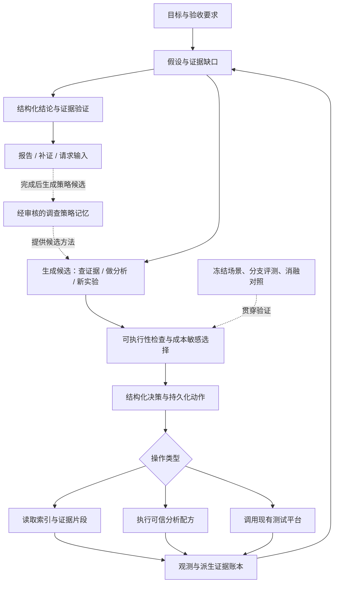

# 游戏测试 Agent 能力增强方案：从执行闭环到主动诊断

日期：2026-09-29。本文是待实施方案，不代表新增能力已经实现或通过验收。

## 1. 建议优先做什么

建议围绕一个目标完善项目：**让 Agent 能解释“为什么下一步值得做”，并用更少的测试获得足够可靠的结论。**

保留现有调查内核、平台适配、动作账本和预算边界，在其上补强四项能力，再用一套对照评测证明价值：

| 优先级 | 改进方向 | 用户能感受到的变化 | 面试交流的核心问题 |
|---|---|---|---|
| P1 | 假设驱动的实验选择 | 从机械复跑变成选择有区分能力的下一步 | 如何让 Agent 做有价值的调查？ |
| P1 | 按需取证与受控分析闭环 | 大日志不必全塞给模型，能定位、计算并回溯 | 如何管理上下文，又不漏掉关键证据？ |
| P2 | 可验证的调查策略记忆 | 后续任务复用有效方法，并避开已知无效路径 | 记忆如何真正改善行为，而非只是多检索一段文字？ |
| P1 基础、P2 语义增强 | 证据约束的结论验证 | 报告中的每个重要结论都有明确依据和范围 | 如何防止答案正确但理由不忠实？ |
| 全程建设 | 分支环境与消融评测 | 能比较新旧架构的质量、成本和稳定性 | 如何证明提升来自架构，而非运气或换模型？ |

最小可展示版本先做“实验选择 + 取证/分析 + 结论验证的规则部分 + 小型评测”。案例记忆在有可信轨迹后接入，语义评审按实际错误类型添加。

这里的亮点是面向游戏测试的工程创新，不是声称提出全新算法。参考方法的价值要通过本项目实验检验。

## 2. 为什么这些方向适配当前代码

项目已有的基础很好，但需要区分“有数据结构/服务”和“模型能够在自动闭环中有效使用”。

| 现有基础 | 本次代码检查发现的实际缺口 | 应做的增量 |
|---|---|---|
| Hypothesis、Playbook、PlanDelta、动态实验节点 | 模型主要输出一个 NextStep，没有统一的候选实验比较过程 | 加入候选设计与选择记录，复用已有执行规划 |
| ContextAccess 可搜索证据和读取片段 | 本地 controller 的 retrieve_evidence 分支只转状态，未实际调用片段读取 | 增加明确的读取请求、执行结果及下一轮回注 |
| AnalysisRecipe、AnalysisSandboxService | DecisionValidator 明确拒绝 analyze，自动分析尚未贯通 | 先打通可信分析配方，外部沙盒后置 |
| CaseMemory 生命周期及按条件检索，ContextBuilder 已注入历史案例 | 检索存在，但没有把“复用哪套调查方法”和后续效果稳定关联 | 扩展策略条目、使用记录与结果反馈，不另起一个记忆系统 |
| 报告、来源图、审计与目标评估 | 引用存在不代表结论得到支持，尤其是自由文本理由 | 增加结构化论断与分层验证 |
| evals/trajectory.py 已有实验设计与配对轨迹评分 | 主要评价已有轨迹，还不是根据 Agent 动作推进环境的完整基准 | 加可分支的环境驱动器、冻结任务集和消融实验 |

现有上下文管理、状态机和预算控制继续复用。无需重写整个 Agent，也不以增加独立模型角色数量作为目标。Anthropic 的工程经验强调根据任务选择简单、可组合的工作流，并在确有明确评价标准时采用评估—改进循环。这里借鉴的是这种选择原则。[来源：Building Effective Agents](https://www.anthropic.com/engineering/building-effective-agents)

## 3. 修改后的架构

关键变化在选择下一步和解释结果的中间过程。现有平台执行控制仍是唯一提交入口，新模块不能直接绕过它调用真实测试。

## 4. 亮点一：假设驱动、考虑成本的实验选择

### 4.1 要解决什么问题

“第一次不够，再跑一次”只是基础补证。更有价值的行为是：存在两个或多个解释时，选一个能让它们产生不同预期结果的操作。

例如性能异常可能来自渲染负载、CPU 工作或采样噪声。先查已有 CPU/GPU 时间摘要，可能比直接重跑更便宜；如果没有这些数据，才考虑新增采集。实际候选只能来自平台已声明的能力，不能凭空生成“降低分辨率”“修改随机种子”等平台不支持的参数。

### 4.2 具体设计

扩展现有 Hypothesis，并新增轻量的 ExperimentCandidate、SelectionRecord：

| 字段 | 用途 |
|---|---|
| question / hypothesis_ids | 本次操作想区分什么 |
| capability_ref / parameters | 绑定真实存在的操作及参数 |
| controlled_variables / changed_variables | 哪些条件保持，哪些改变；记录是否实际可控制 |
| predictions | 不同假设下预计看到什么，使用指标区间或明确事件条件 |
| outcome_rules | 观测后如何更新假设，规则无法解释时保留未知 |
| evidence_requirements / comparability | 需要什么输出，哪些构建与环境字段必须一致 |
| estimated_cost / stop_rule | 预计运行、读取和时间成本，以及何时停止 |

执行流程：

1. 复用现有 Playbook 和适用的策略记忆，模型最多提出三个候选，包括只读查询或现有数据分析。
2. 程序先检查能力、参数、资源、证据来源和可比条件，过滤不可执行候选。
3. 比较候选的判别能力与成本，保存入选及未入选理由。
4. 入选候选转换为现有 NextStep 和 PlannedAction，复用执行链路。
5. 实际结果由程序与可验证规则对照，记录支持、削弱或仍无法区分；不直接把一次相关变化升级为根因。

### 4.3 第一版如何判断“有价值”

优先采用可解释的分级排序：能填补必要证据缺口 → 能区分未决假设 → 在同等价值中选择成本较低的候选。不同预算分别检查，不把 Token、设备分钟和风险未经归一化地相加。

可以记录判别覆盖率：候选的可观测预测能区分多少对未决假设。但仅有两段不同自然语言，不足以算作有效区分；需要测量指标或可执行的判定条件。

**暂不计算所谓精确的信息增益。** 当前缺少可靠先验概率和观测似然，模型自报“置信度 90%”不能当作校准概率。未来有足够历史数据后，再评估概率模型是否值得引入。

### 4.4 接入位置与边界

- 修改 contracts/models.py，增加候选及选择记录契约。
- 在 planning 下增加候选生成、检查与排序服务；复用 strategies.py。
- controller 与 Temporal worker 都调用同一服务，再进入 DurableActionPlanner。
- capability 缺少控制变量或构建/环境信息时，先查询、请求补充，或降级为观察；不假定具备因果实验条件。
- 普通单次验证任务走原有快速路径；出现未决假设或明确证据缺口才进入候选设计，控制调用延迟。

### 4.5 如何验收、如何讲

验收：给出含多个有效操作的盲测场景，看是否选择能区分假设的操作；加入“便宜查询足够”“所有实验不可比”“必须先控制噪声”等场景。平台无对应参数时必须正确拒绝该候选。

完成后可讲：**“我给 Agent 增加了结构化实验设计，让它在真实能力约束下比较候选操作，优先解决证据缺口，再权衡实验的判别能力和成本。”**

这是本方案最应优先展示的能力。Playbook 提供实验方法，程序提供边界，模型负责结合当前情况提出和解释候选。

## 5. 亮点二：按需取证与受控分析，组成真正的工具闭环

### 5.1 参考经验与项目改法

Anthropic 的上下文工程文章介绍了即时取用和渐进披露：先保留轻量引用，需要时再读取细节。这里将它适配为“证据目录 → 片段 → 可复核计算结果”的三级路径。[来源：Effective Context Engineering for AI Agents](https://www.anthropic.com/engineering/effective-context-engineering-for-ai-agents)

### 5.2 先修闭环，再加检索算法

第一步，为 retrieve_evidence 提供结构化 ReadRequest：证据 ID、查询条件、偏移、最大字节数和读取目的。提供受控的 search_evidence 操作，让模型能发现不在当前上下文中的证据引用。

读取服务执行权限检查和预算预留，返回含内容哈希、位置、截断状态和来源版本的 Excerpt。结果持久化为读取记录，并明确进入下一轮上下文；重复读取同一版本同一范围可命中缓存。缓存可减少物理 I/O，但逻辑调用仍计数，防止模型空转。

第二步，为 analyze 增加 AnalysisRequest，只允许引用已注册 recipe_id、版本及证据输入。首批选择程序可以独立复核的配方，例如：

- CSV 分位数、样本量和缺失值统计；
- 多次运行的指标对比，并显式检查单位、窗口和可比字段；
- 日志错误计数及对应原文位置。

验证器只在配方、输入和预算可用时接受 analyze。执行输出必须保存输入哈希、配方版本、参数和输出哈希，作为派生证据回到账本。controller、worker 和上下文构建统一使用这套结果。

外部沙盒保留为后续扩展：当固定配方覆盖不足时再引入。第一期不让模型生成任意 Python，也不把仅有 SandboxRunner 协议当成可用隔离环境。

### 5.3 再增强索引与上下文

初始索引按 Run、构建、环境、Artifact 类型、时间窗和解析章节组织；文本检索先用现有过滤与确定性搜索。任务规模证明需要后再加全文或向量索引。

将上下文分为三类：必须保留的当前状态、与本轮问题有关的证据片段、按需加载的参考资料。摘要中保存证据指针和未解决冲突，不把未读取内容描述成已验证事实。

### 5.4 如何验收、如何讲

验收：准备“元数据相同、关键结论藏在日志中间”的成对场景。Agent 必须实际读取相应片段，不能仅凭文件名或 Run passed 得出结论。再加入超长文件、证据更新、预算耗尽和伪造日志指令；日志文本不得获得修改策略或执行权限。

测量证据命中率、无依据结论率、每任务输入 Token、读取字节数与延迟。压缩收益要在结论质量不下降的前提下比较。

完成后可讲：**“上下文是可检索的工作集。模型先定位证据，再调用受控分析配方，计算结果携带完整输入和规则来源回到调查中。”**

## 6. 亮点三：从案例检索升级为可验证的调查策略记忆

### 6.1 参考经验

Agent Workflow Memory 研究从经验中提取可复用工作流，并选择性地提供给后续任务。Reflexion 探索利用反馈与语言记忆改善后续尝试。这些工作启发本方案保存调查方法和失败教训，但论文结果不能直接作为本项目收益。[来源：Agent Workflow Memory](https://arxiv.org/abs/2409.07429)、[Reflexion](https://arxiv.org/abs/2303.11366)

### 6.2 记住“怎么查”，而非直接复用“是什么原因”

扩展现有 CaseMemory，不再新增独立向量记忆服务。策略条目包含：

- 适用条件：引擎/版本范围、异常类型、平台能力、必要环境信息；
- 调查步骤：先查什么、何时分析、何时追加实验；
- 每一步的目的、停止条件和可解释的分支；
- 已知无效路径及其失败条件；
- 来源调查、人工审核状态、使用次数、支持与反例记录。

例如，一条内存增长策略可以建议“区分热身与稳定阶段，再比较循环趋势”，而不是存成“内存增长就是泄漏”。所谓负面记忆也必须限定条件，不能因为一次调查失败就永远禁用某个工具。

### 6.3 与当前项目怎么连接

完成调查后，离线提取策略候选。沿用现有 candidate → reviewed → active 流程，先审核再上线；运行期间只读取 active 且适用的条目。缺少版本等适用字段时降低适用等级或排除，不能默认匹配。

检索先做范围与前提过滤，再按问题类型及文本相关性排序。最多注入少量策略，保存 selection_reason 和 memory_revision。候选实验记录 memory_id，使后续可以追踪是哪条经验影响了选择。

每次使用保存结果反馈，但“用过且任务成功”只算相关证据，不能自动认定记忆有贡献。真正收益通过有/无该记忆的配对测试判断。反例触发待审核状态或人工撤回，避免自动传播错误经验。

### 6.4 如何验收、如何讲

验收：在同一问题族中变化构建、环境或失败原因，测试迁移能力；加入过期策略和误导策略。训练、调优和盲测按问题族/来源轨迹分组，不能把同一日志换个 ID 同时放进记忆和测试集。

完成后可讲：**“我的记忆保存经过验证的调查流程，并记录适用条件和反例。它能影响候选实验，但不能替代当前证据；是否有效通过配对消融衡量。”**

## 7. 亮点四：结论验证器，检查推理与证据之间的连接

### 7.1 目标

把报告分成结构化论断，例如“Run 通过”“指标超过阈值”“某假设得到支持”“构建已验收”。每条论断写明作用范围、证据引用、规则和限制。

### 7.2 两层验证

**第一层：确定性验证，先实施。**

- 引用是否属于当前授权调查、内容是否已取得、版本是否有效；
- 数值是否来自受支持配方和足够样本，单位与比较方向是否一致；
- 独立运行数、构建和环境字段是否满足论断要求；
- 区分“引用已知结构化元数据”和“引用实际读取的正文片段”。读过全文不是引用平台 verdict 的必要条件，但不能未读正文便声称正文证明了某事实。
- 根因类结论在缺少足够实验支持时降级为假设或关联，不用模型措辞强行补齐证据。

**第二层：语义评审，按需启用。**

只对自由文本的关键推断调用只读评审器，输入论断、相关证据和评价规则，输出支持/矛盾/不足及定位。它没有平台执行权限。最多修订一次；仍有问题则降级结论，防止无休止互评。

这借鉴 evaluator–optimizer 的有界反馈方式，但本项目优先由规则检查可计算事实。评审器与生成器使用同一模型时仍可能共同犯错，必须用人工标注校准，不能视为独立真值。[来源：Building Effective Agents](https://www.anthropic.com/engineering/building-effective-agents)

### 7.3 接入与验收

扩展现有报告 Claim 契约，在 reports 发布前增加验证服务；审计记录原论断、验证结果和最终修订。验证器因服务错误不可用时标记“未验证”，不能偷偷当通过；是否允许发布由论断类型和已有规则决定。

验收：设置元数据与日志冲突、警告不影响目标平台、指标正确但证据错引、构建信息缺失等场景。衡量错误论断漏检率和正确论断误拒率，而不是只看评审器输出了多少反馈。

完成后可讲：**“我在报告发布前加入证据约束：程序核对可计算事实，模型只辅助检查语义支持，最终每条论断都保留验证状态。”**

## 8. 如何证明这些亮点有效：建立可分支的调查评测

### 8.1 参考经验与现有基础

Agent 评测需要同时查看行动轨迹和环境中的实际结果，并结合程序检查、模型评价与人工标注。本文采用这一原则，继续扩展现有 trajectory.py，而不是只统计最终回答是否包含关键词。[来源：Demystifying Evals for AI Agents](https://www.anthropic.com/engineering/demystifying-evals-for-ai-agents)

### 8.2 三层验证，各自回答不同问题

| 层次 | 方法 | 能证明什么 |
|---|---|---|
| 固定轨迹回放 | 读取现有账本与冻结快照，不提交平台 | 历史关联、规则检查、格式与恢复逻辑 |
| 可分支离线环境 | 隐藏状态决定不同操作的结果，Agent 自行选择操作 | 是否能选实验、读证据、分析、停止 |
| 小规模真实平台 | 相同验收目标、冻结配置，允许多个合法路径 | 平台集成及选定场景的真实效果 |

离线环境需要覆盖所有允许动作；未建模参数返回明确 unsupported，不默认生成有利结果。环境的隐藏原因与标签不能进入模型可见上下文，也不允许模型自己给自己的“信息增益”打最终分。

注意：新策略选择了历史中没有执行的实验，固定真实账本无法提供它的真实结果。该分支只能在有定义的离线环境验证，或安排真实测试，不能称为真实反事实回放。

### 8.3 起步任务集与对照

建议先准备约 20–30 个任务，覆盖功能失败、性能异常、内存增长、基础设施问题及缺少构建信息；每个问题族包含可补证、已有证据足够和能力不足三类变化。数量是建设建议，不是已经拥有的测试集。

固定同一模型、提示配置、平台预算和初始观测，对比：基线、加实验选择、再加取证/分析、再加策略记忆、再加结论验证。最终还应从完整版本逐项移除模块，防止只靠顺序叠加无法区分模块贡献。

每个任务重复若干次，记录全部失败；为每组分别报告成功比例和区间、不必要 Run 数、设备分钟、Token、延迟。不要用“多试几次至少成功一次”代替单次可靠性；同一问题族的变体不要当作完全独立样本计算置信区间。

**首轮验收门槛建议：**

- 越权引用、预算越界和查询误创建运行：在固定回归集中零违规，但不把测试零违规等同普遍安全保证；
- 新能力在预先指定的独立问题族上表现出基线没有的有效调查路径；
- 若质量相当，比较成本；若质量提高但成本增加，明确给出增加幅度，不用单个总分掩盖取舍；
- 未观察到收益的模块保持关闭，记录负结果。

## 9. 实施拆分与预计投入

以下为熟悉代码的一名开发者的粗略工程估算，不含等待真实设备、建设专业标注数据和独立安全审计。

| 阶段 | 工作 | 预计投入 | 交付与退出条件 |
|---|---|---|---|
| S0 | 保存基线，定义结构化论断与实验设计，选定任务族 | 2–3 人日 | 可重复跑的基线和明确评价规则 |
| S1 | 真正接通取证与可信分析配方，本地/Temporal 共用服务 | 4–6 人日 | 查、读、算能产生新的可引用观测，异常有明确语义 |
| S2 | 候选实验生成、检查、选择，以及确定性结论验证 | 4–6 人日 | 至少两个问题族完成有判别价值的闭环 |
| S3 | 分支评测完善，冻结对照与成本报告 | 3–5 人日 | 能明确说明提升来自哪项改动；与 S1/S2 并行建设数据 |
| S4 | 策略记忆反馈、可选语义评审、完整消融 | 4–6 人日 | 在独立任务上验证收益，具备关闭与回退路径 |

若时间有限，完成 S0–S3 已足够形成完整且可演示的架构亮点。案例记忆和语义评审不必为展示而仓促上线。

## 10. 兼容、成本与风险控制

- **模型兼容：** Qwen 继续使用现有已验证的输出模式。复杂候选设计通过单独、有限字段契约返回，避免让一个 NextStep 膨胀成所有功能的大 Schema。
- **持久化：** 新增记录采用带版本的附加表或字段；旧决策保持可读，不修改既有快照和验收清单。
- **工作流：** 本地与 Temporal 共用领域服务。改变活动参数或执行顺序时做版本迁移与历史重放测试，不能只验证本地路径。
- **资源：** 候选生成、取证、分析、评审各有预算；限制候选数量、片段大小及修订次数。把额外模型调用计入端到端成本。
- **回退：** 实验选择、策略记忆、语义评审分别可关闭。系统故障时回到已支持的调查路径，并保留未完成原因；不能吞掉失败后假装任务已完成。
- **平台依赖：** 先以真实能力目录为准。缺少构建哈希、环境指纹和实际消耗时，只能降低结论范围，Agent 不能通过推理补造它们。

## 11. 面试中可以形成的完整叙述

完成并验证后，可以围绕下面这段话展开，括号里的指标要用真实数据填写：

> 我把游戏测试 Agent 从执行任务的闭环，扩展成主动诊断闭环。它先整理证据缺口与竞争假设，再比较查询、分析和真实实验的判别价值与成本。大文件按需读取，统计由受控配方计算，结论经过证据验证。完成的调查可以提炼为有适用条件的策略记忆。我通过冻结任务集和逐项消融，比较改动前后的调查成功率、不必要运行次数和总成本，确认哪些组件确实带来收益。

面试官继续追问时，优先展示三样材料：

1. 一张候选实验比较表：为什么选它、为什么不选另外两个；
2. 一条可复查的证据链：原始 Run → 片段/指标 → 假设更新 → 最终论断；
3. 一张消融结果表：质量与成本如何变化，以及仍然失败的场景。

方案阶段使用“我计划/我设计了”；完成实现和验收后再使用“我实现/我验证了”。

## 12. 本地代码入口与参考依据

本方案基于本次检查的代码，实施前应再次确认代码版本。下列是已有文件，文中新增类型和服务尚待实现：

- [决策与工作流](../src/game_test_agent/workflows/controller.py)
- [决策校验器](../src/game_test_agent/planning/decision_validator.py)
- [诊断模板](../src/game_test_agent/planning/strategies.py)
- [证据搜索与读取](../src/game_test_agent/context/access.py)
- [分析配方](../src/game_test_agent/analysis/recipes.py)
- [案例记忆](../src/game_test_agent/memory/cases.py)
- [轨迹评测](../src/game_test_agent/evals/trajectory.py)

外部一手资料已在对应设计处链接，查阅日期为 2026-09-29。它们提供方法启发；候选排序、适用性规则、平台映射和验收门槛均是本项目的设计建议，不是原文结论，也没有预先承诺性能提升。
