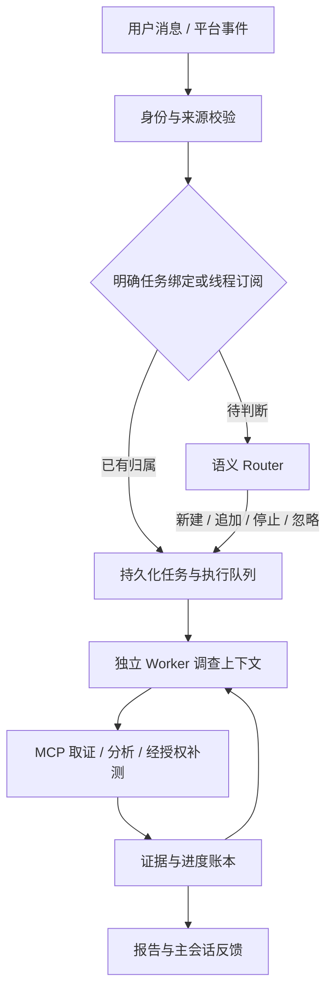

# 架构与事件入口

用户通过一个主会话发起、跟进和查看多个调查。外部异常也可在授权范围内触发调查；每项调查独立保存证据、预算、进度和报告。

## Router 与 Worker



- **Router**：根据消息、任务摘要和必要历史判断任务归属，维护轻量全局上下文。明确绑定与已订阅线程的后续消息可直达任务；主题相似本身不足以确定归属。
- **Worker**：独立运行计划、执行、观测与评估闭环，通过 MCP 读取平台能力和证据；工具权限与预算决定是否可以补测。超出任务范围的输入可退回重新路由。
- **执行与恢复**：数据库保存路由决定、任务状态、证据引用及检查点；持久化投递与并发控制负责启动执行。Local 适合本地单进程，Temporal 用于持久工作流。
- **上下文与报告**：近期摘要内联，完整历史与证据按需召回；报告保留证据引用。工具成功、测试通过和根因确认分别判断，证据不足时明确说明。

工作台集中展示主会话、待关注事项、后台调查、来源事件、授权与报告。任务之间的上下文和权限保持隔离。

## 外部事件

模型配置见根目录 README。开启 `GTA_ENABLE_MODEL` 后，未显式设置的 `GTA_ENABLE_SEMANTIC_ROUTER` 默认同时开启；显式关闭仍有效。语义判断可能存在歧义，不能替代权限检查。

观察事件自动新建调查默认关闭。需要在 `GTA_EVENT_SOURCE_POLICIES_JSON` 中登记来源、租户、项目与只读授权，例如：

```json
[
  {
    "source": "test-monitor",
    "tenant_id": "studio-a",
    "project_id": "game-a",
    "scopes": ["tests:read", "runs:read", "evidence:read"],
    "policy_profile": "bounded-diagnosis",
    "allow_observation_investigations": true,
    "max_observation_tasks": 4
  }
]
```

观察事件须带有效的 `conversation_id`，并通过原有 HTTP/MQ 入口授权。明确归属的线程事件优先进入已有调查；无归属的失败事件才可按来源策略新建。无会话锚点的项目级异常走 `anomaly.detected` 入口。

自动创建的观察调查只读，最多 6 轮、12 次读取、180 秒，并受主会话预算限制；真实运行和设备分钟额度为 0。默认每会话、每来源最多自动创建 4 个任务，任务结束不重置额度；外部消息不能扩大权限。

部署与生产配置见[运行说明](operations.md)，代码分析见[沙盒说明](sandbox-code-execution.md)。架构参考 [DeepSeek Super-agent 公开原型](https://github.com/deepseek-ai/dsh-superagent-prototype)，运行时由本项目的 Python 实现承载。
